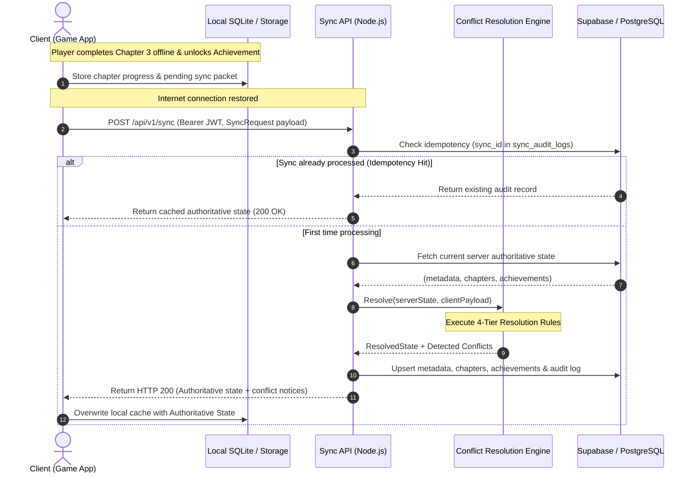

# BE-02: Offline-to-Online Sync Payload Specification
**Project**: Astra Syndicate: Fleet Wars  
**Author**: Mahmoud Mabrouk (Backend Engineer)  
**Deliverable ID**: BE-02  
**Target Phase**: Sprint 1 (Offline & Client Architecture)  
**Output Format**: OpenAPI 3.0 / Architecture Specification  

---

## 1. Executive Summary & Objective

In *Astra Syndicate: Fleet Wars*, mobile and desktop clients operate in intermittently connected environments (such as flights, subway commutes, or poor cellular connections). Players must be able to:
1. Play single-player campaign chapters and earn 1-3 star ratings completely offline.
2. Unlock achievements and accumulate credits/experience without an active internet connection.
3. Modify their fleet loadouts offline.
4. Seamlessly synchronize with the backend cloud once connectivity is restored without data loss or rollbacks.

**Primary Objective**: Deliver a robust, lightweight JSON sync protocol with deterministic conflict resolution to protect player progression at all costs.

---

## 2. Synchronization Architecture & Sequence Flow



---

## 3. JSON Payload Contract

### 3.1 Request Payload (`POST /api/v1/sync`)

```json
{
  "sync_id": "c56a4180-65aa-42ec-a945-5fd21dec0538",
  "client_timestamp": "2026-10-25T21:30:00.000Z",
  "client_version": "1.0.4",
  "device_info": {
    "platform": "Android",
    "model": "Samsung Galaxy S23",
    "os_version": "14.0"
  },
  "chapters": [
    {
      "chapter_number": 2,
      "completed": true,
      "stars": 3,
      "high_score": 14500,
      "completed_at": "2026-10-25T20:15:00.000Z"
    },
    {
      "chapter_number": 3,
      "completed": true,
      "stars": 2,
      "high_score": 11200,
      "completed_at": "2026-10-25T21:10:00.000Z"
    }
  ],
  "achievements": [
    {
      "achievement_id": "ACH_VOID_WALKER",
      "unlocked_at": "2026-10-25T21:10:00.000Z",
      "metadata": { "sector": "Orion-9" }
    }
  ],
  "fleet": {
    "flagship": "Vanguard-II Dreadnought",
    "escorts": ["Corvette-Alpha", "Frigate-Beta", "Cruiser-Gamma"],
    "modules": ["plasma_cannon_v2", "tachyon_shield"],
    "revision_version": 11
  },
  "currency_delta": {
    "credits_earned": 3500,
    "dark_matter_earned": 15,
    "experience_earned": 1200
  }
}
```

### 3.2 Response Payload (`HTTP 200 OK`)

```json
{
  "success": true,
  "data": {
    "sync_id": "c56a4180-65aa-42ec-a945-5fd21dec0538",
    "status": "SUCCESS",
    "server_timestamp": "2026-10-25T21:30:02.150Z",
    "has_conflicts": false,
    "conflicts": [],
    "authoritative_state": {
      "metadata": {
        "player_id": "a0000000-0000-0000-0000-000000000001",
        "level": 6,
        "experience": 5400,
        "credits": 18900,
        "dark_matter": 135,
        "highest_unlocked_chapter": 4,
        "fleet_power": 2100,
        "revision_version": 12,
        "active_fleet_loadout": {
          "flagship": "Vanguard-II Dreadnought",
          "escorts": ["Corvette-Alpha", "Frigate-Beta", "Cruiser-Gamma"]
        }
      },
      "chapters": [
        { "chapter_number": 1, "completed": true, "stars": 3, "high_score": 12500 },
        { "chapter_number": 2, "completed": true, "stars": 3, "high_score": 14500 },
        { "chapter_number": 3, "completed": true, "stars": 2, "high_score": 11200 }
      ],
      "achievements": [
        { "achievement_id": "ACH_FIRST_FLIGHT" },
        { "achievement_id": "ACH_FLEET_EXPANSION" },
        { "achievement_id": "ACH_VOID_WALKER" }
      ]
    }
  }
}
```

---

## 4. Conflict Resolution Engine (The 4 Core Rules)

When synchronizing offline states, conflicts naturally occur if a player plays on another device, replays a level with lower performance, or attempts to manipulate local clock/state. The backend resolves these via 4 deterministic rules:

### Rule 1: Monotonic Chapter Progression (High-Water Mark)
* **Goal**: Never downgrade or roll back player achievements.
* **Stars**: `resolvedStars = Math.max(server.stars, client.stars)`
* **Score**: `resolvedHighScore = Math.max(server.highScore, client.highScore)`
* **Highest Chapter**: `highestUnlocked = Math.max(server.highest, client.highestUnlocked)`
* *Conflict Handling*: If a client submits a lower score or star count for an already completed chapter, the higher server value is strictly preserved, and a conflict note is returned in the response.

### Rule 2: Additive Achievement Set Union
* **Goal**: No offline accomplishment is ever lost.
* **Formula**: $\text{Resolved} = \text{ServerAchievements} \cup \text{ClientAchievements}$
* *Deduplication*: Duplicate achievement IDs are merged idempotently based on earliest `unlocked_at` timestamp.

### Rule 3: Bounded Currency & Delta Anti-Cheat
* **Goal**: Prevent infinite credit exploits via offline client memory modifications.
* **Thresholds**:
  * Max offline credits per sync batch: `50,000`
  * Max offline dark matter per sync batch: `500`
* *Conflict Handling*: If delta exceeds threshold, server caps the addition at the ceiling limit, logs a `CURRENCY_OVERFLOW` conflict audit, and proceeds safely.

### Rule 4: Optimistic Revision Versioning (Fleet Loadout)
* **Goal**: Prevent stale fleet loadouts from overwriting newer configurations.
* **Mechanism**:
  * If `client.revision_version >= server.revision_version`: Client fleet configuration is applied, and version is incremented.
  * If `client.revision_version < server.revision_version`: Client has stale fleet data. Server rejects client fleet update, retains authoritative server fleet, and returns `FLEET_VERSION` conflict.

---

## 5. Zero-Cost Passive Telemetry & Webhooks

To satisfy Task 1.2 (*"Define zero-cost webhook mechanisms for passive data logging"*):
* The endpoint `POST /api/v1/webhooks/log` accepts client telemetry (e.g. `BATTLE_LOST`, `SESSION_START`, `WEAPON_FIRED`).
* Returns `HTTP 202 Accepted` immediately with near-zero latency (< 5ms).
* Asynchronously flushes the event to the `passive_event_logs` table via `setImmediate`, requiring **zero paid analytics SaaS** or dedicated message brokers.
